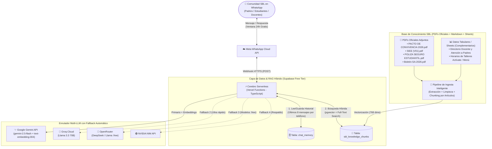

# 🚀 MegaPlan: Bot de WhatsApp Serverless ("BoniBot") con Multi-LLM y RAG Institucional — Colegio San Bonifacio de las Lanzas Bilingüe (Costo $0)

Este documento define la arquitectura técnica, el diseño del RAG híbrido sobre los documentos oficiales adjuntos y la hoja de ruta paso a paso para construir el asistente virtual del **Colegio San Bonifacio de las Lanzas Bilingüe (SBL)** en WhatsApp, operando **24/7 en la nube gratis y sin necesidad de tener un computador encendido**.

---

## 1. ¿Por qué el costo operativo es $0.00?

1. **Meta WhatsApp Cloud API Oficial:**
   - Desde noviembre de 2024, todas las **Conversaciones de Servicio** (cuando un padre de familia, estudiante o docente le escribe primero al bot) son **100% gratuitas e ilimitadas** durante la ventana de 24 horas posteriores a cada mensaje entrante.
   - Como no haremos envíos masivos (outbound marketing), el cobro de Meta es **\$0.00**.
   - Incluye un número de prueba gratuito inmediato en el portal *Meta for Developers* sin exigir tarjeta de crédito.
2. **Hosting Serverless (Vercel Functions / Cloudflare Workers):**
   - El bot vive en un Webhook HTTPS que se activa solo durante los milisegundos que dura el procesamiento de un mensaje y nunca "se duerme" (hasta 100,000 peticiones gratuitas al mes).
3. **Base de Datos y Vectores (Supabase Free Tier):**
   - PostgreSQL + `pgvector` gratuito (500 MB, suficiente para más de 100,000 fragmentos de documentos y decenas de miles de mensajes de memoria conversacional).
4. **Enrutador Multi-LLM Gratuito:**
   - Combina las capas gratuitas de **Google Gemini**, **Groq**, **OpenRouter** y **NVIDIA NIM** con conmutación automática (*fallback*) en caso de límite de cuota.

---

## 2. Arquitectura del Sistema



---

## 3. Auditoría de los Documentos Institucionales Adjuntos (Base del RAG)

Ya contamos en la carpeta raíz con **4 documentos oficiales reales de la Corporación Colegio San Bonifacio de las Lanzas Bilingüe (Ibagué)** que serán el corazón del RAG:

| Archivo en la Carpeta | Páginas | Contenido Clave Identificado | Estrategia de Fragmentación (Chunking) |
| :--- | :---: | :--- | :--- |
| **[PACTO DE CONVIVENCIA 2026.pdf](./PACTO%20DE%20CONVIVENCIA%202026.pdf)** | 121 | • **Filosofía y Ciclos:** Exploratorio (Transición a 2°), Conceptual (3° a 6°), Contextual (7° a 9°), Proyectivo (10° y 11°).<br>• **Uniformes (Art. 4-5):** Gala, diario, natación, reglas de Jean Day.<br>• **Disciplina y Debido Proceso (Título V):** Incumplimientos leves, graves y muy graves; llegadas tarde (Art. 22), copia/IA (Art. 24), celulares (Art. 26).<br>• **Servicios (Título VII-IX):** Bilingüismo, Pastoral, Talleres "Actívate", Proyecto Carlo Acutis y 80h de Servicio Social (sábados 7am-12m), Enfermería (protocolo medicamentos), CRAI, Piscina, Alimentación.<br>• **Costos 2026 (Título XII):** Tablas exactas de Matrículas (Art. 122), Pensiones y recargos día 11 y 21 (Art. 125-126), Alimentación (\$4.150.000/año), Certificados (\$9.500 / \$18.800 en inglés), Derechos de grado (\$440.000).<br>• **Calendario y Horarios 2026 (Art. 130-133):** Fechas de los 3 periodos, vacaciones, horarios de entrada/salida/almuerzo por ciclo y trámite de permisos (1 día vs. 2+ días). | **Chunking Estructural por Artículo y Título:** Cada artículo (`Artículo 1` al `Artículo 134`) se indexará preservando su número, título y tablas en formato Markdown para que el bot cite el artículo exacto. |
| **[SIEE (V01).pdf](./SIEE%20(V01).pdf)** | 43 | • **Glosario y Escala de Valoración:** 4 niveles de idoneidad y su equivalencia numérica: *Inicial* (Bajo - 6.0), *Esperado* (Básico - 8.5), *Avanzado* (Alto - 9.5) y *Excelencia* (Superior - 10.0).<br>• **Promoción y Grado 11° (Art. 2-4):** Asistencia mínima 85%, requisito IELTS Académico mínimo B2 (Band Score 6.0) y 80h servicio social; promoción anticipada.<br>• **Apoyo y Nivelación (Art. 8-10):** Tutoriales, Asesorías, Mentorías académicas (10° y 11° apoyando en TechnoScience, Matemáticas, Humanidades y Sociales), *Catch Up Week*, Nivelaciones por periodo (3 asesorías + 1 evaluación) y remediales.<br>• **Pruebas Estandarizadas (Art. 11):** Starters (1°), Movers (2°), A2 Key (4°-5°), B1 Preliminary (7°), B2 First (9°), IELTS y Saber 11 (10°-11°). | **Chunking por Artículo + Tablas Markdown:** Especial cuidado en las tablas de equivalencia numérica y pruebas por grado. |
| **[POLIZA SEGURO ESTUDIANTIL.pdf](./POLIZA%20SEGURO%20ESTUDIANTIL.pdf)** | 1 | • **Seguros Mundial — Póliza N° `2000694412`** (aplica para todos los estudiantes).<br>• **Red de atención en Ibagué:** Clínica Asotrauma, IDIME (sin urgencias), Dento-Man, Clínica de Ojos del Tolima, Hospital Federico Lleras Acosta, Clínica Ibagué, Urocadiz, Avidanti, Clínica Keralty.<br>• **Tabla de Amparos:** Gastos médicos (\$18.000.000), muerte/incapacidad (\$18.000.000), rehabilitación (25 SMMLV), ambulancia aérea (\$16.000.000), telemedicina y orientación psicológica/pediátrica incluida. | **Documento Estructurado en Markdown:** Al ser un infográfico visual de 1 página, lo convertiremos a un archivo `.md` limpio y completo para que la precisión al consultar clínicas, teléfonos y coberturas sea del 100%. |
| **[Boletin-SA-2026.pdf](./Boletin-SA-2026.pdf)** | 3 | • **Boletín Proyecto Social Carlo Acutis (Semestre A, 2026):** 10 jornadas realizadas con 100 niños de la Comuna 6 de Ibagué.<br>• Entrega de kits escolares, uniformes y 100 pares de tenis (gracias al mini bazar de los viernes).<br>• Preparación de Primera Comunión (14 niños con Parroquia María Reina), 5 talleres sabatinos con Fundación Rescatando Vidas, 2 Escuelas de Padres y estrategia *"De corazón a corazón"*.<br>• Contacto Plan Padrino: `312 453 4990`. | **Markdown Curado + Chunks Semánticos:** Ideal para responder a padres interesados en el impacto social, donaciones o el Plan Padrino. |

### Datos Inventados Complementarios (CSV / Google Sheets) 📊
Para cumplir el objetivo de combinar documentos con hojas de cálculo (Sheets), agregaremos en `data/sheets/` dos tablas con datos de ejemplo listos para sincronizar con un Google Sheet real:
1. `directorio_docentes_y_atencion.csv`: Correos institucionales (`@sanboni.edu.co`), líderes de área (TechnoScience, Matemáticas, Inglés, etc.), psicorientadores y horarios de atención a padres por ciclo.
2. `horarios_activate_y_menu.csv`: Horarios y días de los talleres extracurriculares del programa **Actívate** (fútbol, voleibol, baloncesto, natación, robótica, música, porras) y el menú semanal de cafetería/almuerzo.

---

## 4. Diseño de los Componentes Técnicos

### A. Búsqueda Híbrida (Vector + Full-Text Search en Supabase)
Cuando un padre o estudiante pregunte algo en WhatsApp:
1. **Generación de Embedding:** Convertimos la pregunta en un vector de 768 dimensiones con `text-embedding-004` de Gemini.
2. **Consulta RPC Híbrida (`match_sbl_documents`):**
   - Busca por **similitud coseno** (conceptos como *"¿qué pasa si mi hijo pierde una materia en el último periodo?"* $\rightarrow$ recupera nivelaciones remediales del SIEE).
   - Combina con **búsqueda de texto completo en español** (palabras exactas como *"2000694412"*, *"Asotrauma"*, *"IELTS"*, *"Catch Up Week"*, *"Artículo 22"*).
3. **Citas Oficiales:** El System Prompt obligará al bot ("BoniBot 🦊", inspirado en Boni, la mascota del colegio) a responder únicamente con base en los fragmentos recuperados y citar la fuente (ej. *"Según el Artículo 131 del Pacto de Convivencia 2026..."*).

### B. Enrutador Multi-LLM con Conmutación por Error (Fallback)
```text
[Mensaje + Contexto RAG + Historial]
       │
       ▼
1. Google Gemini (gemini-2.5-flash) ──► ¿Éxito? ──► Responde al usuario
       │ (Si hay Error 429 / Timeout > 8s)
       ▼
2. Groq Cloud (llama-3.3-70b-versatile) ──► ¿Éxito? ──► Responde al usuario
       │ (Si hay Error 429 / Caída)
       ▼
3. OpenRouter (Modelos gratuitos :free) ──► ¿Éxito? ──► Responde al usuario
       │ (Si hay Error)
       ▼
4. NVIDIA NIM API (meta/llama-3.1-70b-instruct) ──► Responde al usuario
```

### C. Memoria Conversacional por Contacto
- Tabla `chat_memory` en Supabase indexada por `phone_number`.
- Almacena los mensajes recientes y se inyectan los últimos 6–8 turnos en el prompt.
- Incluye comandos rápidos de administración por chat:
  - `/reset` o `/nuevo`: Borra el historial de memoria de ese número para empezar una consulta limpia.
  - `/estado`: Muestra qué proveedor LLM respondió el último mensaje y cuántos fragmentos RAG utilizó.

---

## 5. Estructura del Proyecto en esta Carpeta

```text
c:\Users\cp\Downloads\Bot Whatsapp\
├── MEGAPLAN.md                        # Este documento maestro
├── PACTO DE CONVIVENCIA 2026.pdf      # Documento oficial SBL
├── SIEE (V01).pdf                     # Documento oficial SBL
├── POLIZA SEGURO ESTUDIANTIL.pdf      # Documento oficial SBL
├── Boletin-SA-2026.pdf                # Documento oficial SBL
├── data/
│   ├── markdown/                      # Versiones Markdown curadas (ej. póliza, boletín, FAQs)
│   └── sheets/                        # Archivos CSV / Conector a Google Sheets
│       ├── directorio_docentes.csv
│       └── talleres_activate_menu.csv
├── api/
│   └── webhook.ts                     # Endpoint Serverless para Vercel (GET y POST de Meta)
├── src/
│   ├── config/
│   │   └── env.ts                     # Carga y validación de API Keys
│   ├── llm/
│   │   ├── router.ts                  # Enrutador Multi-LLM (Gemini -> Groq -> OpenRouter -> NVIDIA)
│   │   └── embeddings.ts              # Embeddings gratuitos con Gemini
│   ├── rag/
│   │   ├── retriever.ts               # Búsqueda híbrida en Supabase
│   │   └── prompt.ts                  # Identidad de "BoniBot" + reglas de citación institucional
│   ├── memory/
│   │   └── session.ts                 # Historial de conversación por teléfono en Supabase
│   └── whatsapp/
│       └── metaClient.ts              # Envío de mensajes y doble check azul ("leído")
├── scripts/
│   ├── setup_supabase.sql             # SQL listo para crear tablas, pgvector y búsqueda híbrida
│   ├── ingest.ts                      # Extrae texto de los 4 PDFs + CSVs/Sheets y sube vectores a Supabase
│   └── chat_cli.ts                    # Simulador en terminal para probar todo el bot sin WhatsApp
├── package.json
├── tsconfig.json
├── vercel.json
└── .env.example
```

---

## 6. Fases de Implementación

- [ ] **Fase 1: Inicialización y Extracción de Conocimiento SBL**
  - Configurar proyecto TypeScript/Node.js.
  - Crear versión Markdown estructurada de `POLIZA SEGURO ESTUDIANTIL.pdf` y `Boletin-SA-2026.pdf`, configurar el extractor automático por artículos para `PACTO DE CONVIVENCIA 2026.pdf` y `SIEE (V01).pdf`, y generar los CSVs complementarios (directorio y talleres Actívate).
- [ ] **Fase 2: Enrutador Multi-LLM (`LLMRouter`)**
  - Programar el cliente unificado con soporte para Gemini, Groq, OpenRouter y NVIDIA NIM, con prueba de fallback.
- [ ] **Fase 3: Base de Datos Supabase (RAG + Memoria)**
  - Crear script `scripts/setup_supabase.sql`.
  - Ejecutar `npm run ingest` para poblar la base vectorial y probar consultas reales en el simulador de consola (`npm run chat`).
- [ ] **Fase 4: Webhook de WhatsApp y Despliegue Serverless en Vercel**
  - Crear `api/webhook.ts` y el cliente de Meta WhatsApp Cloud API.
  - Desplegar en Vercel (100% gratis, encendido 24/7) y enlazar con el panel de Meta for Developers.
- [ ] **Fase 5: Conector en Vivo con Google Sheets**
  - Permitir que el bot o el script de ingesta lea directamente una URL de Google Sheets publicada como CSV para actualizar horarios o directorios sin tocar el código.
